# Job Butler: the job seeker's journey, key steps

The main path a job seeker takes, from install to a submitted application and the digest that follows. Each Stage is one step here, with its worker subagent beside it. For every step, see [the full chart](job-butler-user-journey.md).

Labels use the terms in [GLOSSARY.md](../GLOSSARY.md). Terms without a glossary entry are marked **(not in glossary)**: pipeline run and Digest.

## Key

| Shape | Meaning |
|---|---|
| Rounded box `([ ])` | Start or end of the journey |
| Rectangle `[ ]` | A Stage, or a step the job seeker takes |
| Diamond `{ }` | A decision |
| Hexagon `{{ }}` | A Checkpoint: the job seeker's yes is recorded as an Approval |
| Solid arrow | The next step |
| Dashed arrow | Back to an earlier step |

Each Stage's worker subagent does the unattended judgment: `discover-worker`, `screen-worker`, `tailor-worker`, `apply-worker` and `track-worker`. The worker reads only and returns JSON; the core checks and writes it.

## The chart

```mermaid
flowchart TD
    START(["Install the plugin and run npm install"]) --> SETUP["/job-butler:setup<br/>builds the Profile and creates Preferences"]
    SETUP --> PROFILE{"Profile complete?"}
    PROFILE -->|"no: redo the missing sections"| SETUP
    PROFILE -->|"yes"| GATE{"Pipeline run starts?<br/>Preferences valid, no other run in progress"}
    GATE -->|"no"| SETUP

    GATE -->|"yes"| TRACK["Track<br/>track-worker reads new mail,<br/>proposes Status changes"]
    TRACK --> DISCOVER["Discover<br/>reads Target company boards into Listings;<br/>discover-worker judges pairs that may be the same job"]
    DISCOVER --> SCREEN["Screen<br/>screen-worker rates Listings against the Base resume;<br/>builds the Shortlist ranked by Fit score"]
    SCREEN --> PICK{{"Checkpoint: Shortlist pick<br/>job seeker says yes to each Listing"}}
    PICK -.->|"Approval"| APPLICATION["Application created for each pick<br/>Status: picked"]
    PICK -->|"no picks"| DIGEST
    APPLICATION --> TAILOR["Tailor<br/>tailor-worker writes a tailored resume per Application,<br/>waves of up to 3; job seeker edits"]
    TAILOR --> APPLY["Apply<br/>apply-worker builds the Fill plan;<br/>apply fill in a visible browser, reads every field back"]
    APPLY --> HANDOVER{{"Checkpoint: Handover<br/>job seeker reviews, then clicks Submit"}}
    HANDOVER -.->|"Approval"| SUBMITTED["Status: submitted<br/>Event log entry"]
    HANDOVER -->|"not yet"| DIGEST
    SUBMITTED --> DIGEST["Digest (not in glossary)<br/>what needs the job seeker"]
    DIGEST --> STATUS{{"Checkpoint: digest Status changes<br/>job seeker says yes to each change"}}
    STATUS -.->|"Approval"| MOVE["Status move<br/>Event log entry, Decision tree redrawn"]
    STATUS -->|"no changes"| DONE
    MOVE --> DONE(["Pipeline run ends.<br/>Later runs: Track reads mail about the submitted Applications"])
    DONE -.->|"next run"| TRACK
```

## In words

1. Install the plugin and run `npm install`.
2. Run `/job-butler:setup` to build the Profile and create Preferences. Repeat any missing section.
3. A pipeline run starts once the Profile is complete and the Preferences are valid.
4. **Track** reads new mail and proposes Status changes.
5. **Discover** reads Target company boards into Listings. A worker judges pairs that may be the same job.
6. **Screen** rates the Listings and builds the Shortlist. The job seeker picks at the Shortlist pick Checkpoint, and each pick becomes an Application.
7. **Tailor** writes a tailored resume for each Application. The job seeker edits it.
8. **Apply** builds the Fill plan and fills the form in a visible browser. It stops at the Handover, and the job seeker clicks Submit.
9. The **Digest** lists what needs the job seeker. Status changes take effect only after an Approval.

## Notes on the glossary

- The glossary places Checkpoints in Apply or Track. The Shortlist pick is in Screen, so the chart shows it there.
- The pipeline run and the Digest have no glossary entry, so they are flagged.
