# Job Butler: the job seeker's journey, every step

This chart follows one job seeker from installing the plugin to a submitted application and its tracked outcome. It shows every setup section, every Stage step, the retries, the waves, the pause and blocker paths, and the scheduled run. For the main steps only, see [the key-steps chart](job-butler-key-steps.md).

Labels use the terms in [GLOSSARY.md](../GLOSSARY.md). Four terms the skills use have no glossary entry, so they appear in plain words and are marked **(not in glossary)**: pipeline run, Digest, scheduled run and wave.

## Key

| Shape | Meaning |
|---|---|
| Rounded box `([ ])` | Start or end of a journey |
| Rectangle `[ ]` | A step the core or a skill performs |
| Diamond `{ }` | A decision, or a job seeker reply |
| Hexagon `{{ }}` | A Checkpoint: the job seeker must say yes, and that yes is recorded as an Approval |
| Solid arrow | The next step |
| Dashed arrow | An Approval, or a Checkpoint's outcome |

Worker subagents are the unattended judgments. The Stage skill dispatches them, they only read, and they return one JSON object for the core to check and write. A worker is named in the step that dispatches it.

## The full chart

```mermaid
flowchart TD
    START(["Job seeker installs the plugin"]) --> INSTALL["npm install in the plugin folder<br/>also run npx playwright-core install chromium, for Apply"]
    INSTALL --> SETUPCMD(["/job-butler:setup"])

    subgraph SETUP["Setup: builds the Profile and creates Preferences"]
        direction TB
        S1["init: makes the data directory private and git-ignored"] --> S2["profile check: shows what is missing"]
        S2 --> S3["Mail connectors: Gmail and Google Calendar for Track<br/>tell the job seeker if they are not connected"]
        S3 --> S4["base_resume: import the resume, structure every fact with its source,<br/>optional LinkedIn, GitHub and portfolio sources, job seeker approves reviewed_at"]
        S4 --> S5["identity: name, email, phone, location, country"]
        S5 --> S6["targets: roles, seniority, locations, remote, salary floor, notice period"]
        S6 --> S7{"Is Sponsorship a criterion?"}
        S7 -->|"yes"| S7A["regime uk-skilled-worker, optional new-entrant and relevant-PhD flags"]
        S7 -->|"no"| S8
        S7A --> S8["filters: allow and deny lists, Target companies with their boards,<br/>board detect or boards entered by hand, confirmed_at"]
        S8 --> S9["autonomy: off, nothing runs on its own in this version"]
        S9 --> S10["answer bank: recurring questions, diversity questions set to Prefer not to say"]
        S10 --> S11["Companies House key, optional"]
        S11 --> S12["preferences init, optional opt-in to track External applications"]
        S12 --> S13{"profile check: complete?"}
        S13 -->|"no: redo the sections it names"| S2
    end

    SETUPCMD --> S1
    S13 -->|"yes"| READY(["Profile and Preferences ready"])
    READY --> GATE{"run start: entry gate<br/>Profile complete, Preferences valid, no other run in progress"}
    GATE -->|"refused: relay the message"| SETUPCMD
    GATE -->|"starts"| TRACKSTART

    subgraph TRACK["Track (Stage): reads new mail and proposes Status changes"]
        direction TB
        TRACKSTART["run start track, read the window of new mail"] --> TW["track-worker dispatched once: Gmail and Calendar, read only,<br/>classifies each job-related message"]
        TW -->|"Gmail tools missing"| TGMAIL["tell the job seeker to connect Gmail in claude.ai"]
        TW --> TREC["track record: sure matches pre-selected, probable matches explained"]
        TREC -->|"CLASSIFICATION_INVALID: retry once"| TW
        TREC --> TREPLY{"Job seeker reply"}
        TREPLY -->|"dismiss n"| TDISMISS["mail dismissed"]
        TREPLY -->|"assign message to Application"| TASSIGN["match the mail to an Application"]
        TREPLY -->|"dismiss-mail"| TNEVER["never raised again"]
        TREPLY -->|"alerts"| TALERTS["take in LinkedIn job-alert emails, see Discover"]
        TREPLY -->|"job seeker says an Application was withdrawn or has gone quiet"| TPROP["track propose withdrawn or no_response"]
        TREPLY -->|"approve n: Status change"| TDIGEST
        TDISMISS --> TREPLY
        TASSIGN --> TREPLY
        TNEVER --> TREPLY
        TPROP --> TREPLY
    end

    TGMAIL --> TEND
    TREPLY -->|"done"| TEND["run end, unless the run was joined"]

    TDIGEST{{"Checkpoint: digest Status changes<br/>job seeker says yes to each change"}}
    TDIGEST -.->|"Approval: digest-status"| TSTATUS["application status: Status move,<br/>Event log entry, Decision tree redrawn"]
    TSTATUS --> TREPLY

    TEND --> DISCSTART

    subgraph DISCOVER["Discover (Stage): reads Target company boards into Listings"]
        direction TB
        DISCSTART["run start discover"] --> DCHOICE{"Did the job seeker give a LinkedIn job,<br/>or ask for LinkedIn alerts?"}
        DCHOICE -->|"pasted link or text"| DLI["linkedin add: LinkedIn-only Listing,<br/>matched to a Target company if one fits"]
        DCHOICE -->|"alert emails"| DALERT["alert-worker: reads LinkedIn alert emails, read only"]
        DALERT --> DLI
        DLI --> DLIEND["report the pairing, end the run"]
        DCHOICE -->|"neither: board read"| DBOARDS["discover boards: reads every Target company board,<br/>creates the Discover run, adds Sightings, marks gone Listings"]
        DBOARDS --> DSAME{"Are there pairs that may be the same job?"}
        DSAME -->|"yes"| DWORKER["discover-worker: 'same job?' verdicts, one batch"]
        DWORKER --> DCONF["discover confirm: merges confirmed pairs, keeps the rest apart"]
        DCONF -->|"JUDGMENT_INVALID: dispatch once more"| DWORKER
        DSAME -->|"no"| DLM
        DCONF --> DLM["linkedin match: LinkedIn-only Listings paired with board postings"]
        DLM -->|"candidates to judge"| DLMW["discover-worker: 'LinkedIn match' verdicts"]
        DLMW --> DLMC["linkedin confirm: match merges, null keeps apart"]
        DLM -->|"none"| DREPORT
        DLMC --> DREPORT["report: New, Merged, Paired with LinkedIn, Reposts,<br/>Gone, and every failed or skipped board"]
        DREPORT --> DSPLIT{"Does the job seeker want a wrong merge undone?"}
        DSPLIT -->|"yes"| DSPLITCMD["listing split: the alias becomes its own Listing"]
        DSPLITCMD --> DREPORT
        DSPLIT -->|"no"| DEND2["run end, unless the run was joined"]
    end

    DLIEND --> DEND2
    DEND2 --> SCRSTART

    subgraph SCREEN["Screen (Stage): scores new Listings, builds the Shortlist, picks"]
        direction TB
        SCRSTART["run start screen"] --> SPEND["screen pending: Listings not gone and not picked,<br/>or marked for rescore"]
        SPEND --> SEMPTY{"Any Listings waiting?"}
        SEMPTY -->|"no"| SDIG
        SEMPTY -->|"yes"| SEMP{"Is Sponsorship a criterion?"}
        SEMP -->|"yes"| SEMPM["employer match: company and town against the sponsor register"]
        SEMP -->|"no"| SWORK
        SEMPM --> SWORK["screen-worker: one batch dispatch, rates skills against the Base resume"]
        SWORK --> SREC["screen record: checks run in order: scam gate, deny list,<br/>Ghost job score, Sponsorship, Fit score, Application limit"]
        SREC -->|"JUDGMENT_INVALID: dispatch once more, then relay the error"| SWORK
        SREC --> SDIG["screen digest: Shortlist ranked by Fit score, Excluded collapsed"]
        SDIG --> SREPLY{"Job seeker reply"}
        SREPLY -->|"why letter"| SWHY["screen why: each check, rule and evidence"]
        SWHY --> SREPLY
        SREPLY -->|"show excluded, restore"| SRESTORE["restore a Listing excluded by a check: no Approval needed"]
        SRESTORE --> SDIG
        SREPLY -->|"rescore letter or all"| SRESCORE["screen rescore: only when asked"]
        SRESCORE --> SPEND
        SREPLY -->|"pick a, b"| SPICK{{"Checkpoint: Shortlist pick<br/>job seeker says yes to each Listing"}}
        SPICK -.->|"Approval: shortlist-pick"| SAPP["application pick: one Application per Listing,<br/>Status picked, Event log entry"]
        SAPP --> SDIG
        SREPLY -->|"done"| SEND2["run end, unless the run was joined"]
    end

    SEND2 --> PICKED{"Did the job seeker pick any Listings?"}
    PICKED -->|"no"| DIGEST0
    PICKED -->|"yes"| TLSTART

    subgraph TAILOR["Tailor (Stage): writes one tailored resume per picked Application"]
        direction TB
        TLSTART["run start tailor"] --> TPEND["tailor pending: Picked Applications"]
        TPEND --> TEMPTY{"Any Applications waiting?"}
        TEMPTY -->|"no"| TEND2["run end, unless the run was joined"]
        TEMPTY -->|"yes"| TWAVE["wave of up to 3: one tailor-worker per Application, in parallel"]
        TWAVE --> TWREC["write the reply, tailor record"]
        TWREC -->|"JUDGMENT_INVALID: retry once, then move on"| TWAVE
        TWREC --> TSHOW["show each Application: keyword table, gaps, changes,<br/>DOCX for upload, PDF, notes folder"]
        TSHOW --> TEDIT{"Job seeker asks for an edit or a cover letter?"}
        TEDIT -->|"plain-words edit"| TEDITW["tailor-worker: changes only what the request touches, core re-renders the files"]
        TEDITW --> TSHOW
        TEDIT -->|"edit needs experience the Base resume lacks"| TSETUP["back to setup: a Profile change, then tailor again"]
        TSETUP --> SETUPCMD
        TEDIT -->|"cover letter needed: a Fill plan has a cover-letter field, or asked"| TCL["tailor-worker: cover letter, tailor cover-letter record"]
        TCL --> TSHOW
        TEDIT -->|"done"| TEND2
    end

    TEND2 --> APSTART

    subgraph APPLY["Apply (Stage): fills each Tailored form in a visible browser, hands over for review"]
        direction TB
        APSTART["run start apply"] --> APPREP["apply prepare: Ready to apply, by hand for LinkedIn-only, paused for gone postings"]
        APPREP --> APWAITING{"Any Applications waiting to be filled?"}
        APWAITING -->|"no"| APCLOSE
        APWAITING -->|"yes"| APWAVE["wave of up to 3: one apply-worker per Application, builds the Fill plan"]
        APWAVE --> APPLAN["apply plan: values checked against their sources"]
        APPLAN -->|"JUDGMENT_INVALID: dispatch once more, then relay"| APWAVE
        APPLAN -->|"unmappable questions"| APANS["job seeker answers each question: apply answer,<br/>the answer stays on this Application"]
        APANS --> APFILL
        APPLAN -->|"Ready to apply"| APFILL["apply fill: visible browser fills each field and reads it back"]
        APFILL -->|"paused: page error, page changed, or a control that would submit"| APPAUSE["relay the reason, keep the partial plan,<br/>apply fill again once the page is fine"]
        APPAUSE --> APFILL
        APFILL -->|"blocked: read-back mismatch or empty required field"| APBLOCK["fix it with apply answer or a new plan, apply fill again"]
        APBLOCK --> APFILL
        APFILL -->|"filled"| APHAND["apply handover: every field and attached file in a code block,<br/>limit warning first if the Application limit is now exceeded"]
        APHAND --> APHO{{"Checkpoint: Handover<br/>job seeker says yes to Submit"}}
        APHO -->|"not yet"| APLEAVE["stays at Handover, apply close if abandoned"]
        APHO -.->|"Approval: handover, action application submitted"| APSUB["application submitted: Status submitted, Event log entry.<br/>The job seeker clicks Submit in the browser themselves"]
        APSUB --> APCLOSE["apply close each open browser, run end"]
        APLEAVE --> APCLOSE
    end

    APCLOSE --> DIGEST0
    DIGEST0["run digest (not in glossary): what needs you, shown as a code block"]
    DIGEST0 --> DREPLY{"Job seeker reply"}
    DREPLY -->|"approve, dismiss, assign, alerts, and so on"| TREPLY
    DREPLY -->|"done"| LATER(["Pipeline run ends.<br/>Later runs: Track reads mail about the submitted Applications"])
    LATER -.->|"next run"| TRACKSTART

    subgraph SCHED["Scheduled run (not in glossary): opt-in, /loop 30m /job-butler scheduled"]
        direction TB
        SCTICK["schedule tick"] --> SCACT{"Action from the tick"}
        SCACT -->|"off or idle"| SCSTOP(["stop, say nothing"])
        SCACT -->|"skipped"| SCSKIP["relay the log, retried on the next tick"]
        SCACT -->|"run"| SCSTAGES["Track, then Discover and Screen, each stopping at its Checkpoint.<br/>Never records an Approval, pick, Tailor, Apply or Status change"]
        SCSTAGES --> SCEND["run end, then a desktop notification on macOS when enabled"]
    end
```

## In words

1. Install the plugin and run `npm install`, which also installs the browser for Apply.
2. Run `/job-butler:setup`. It builds the Profile and creates Preferences, one section at a time, and repeats any section that is still missing.
3. The entry gate starts a pipeline run. It refuses if the Profile is incomplete, the Preferences are invalid, or another run is in progress.
4. **Track** reads new mail. Its worker classifies each job-related message. Status changes wait at the digest Checkpoint, and the job seeker's Approval applies them.
5. **Discover** reads each Target company's board into Listings, or takes in a LinkedIn job or its alert emails instead. A worker judges any pairs that may be the same job.
6. **Screen** rates the new Listings against the Base resume and builds the Shortlist. The job seeker picks Listings at the Shortlist pick Checkpoint, and each pick becomes an Application.
7. If anything was picked, **Tailor** writes a resume per Application, in waves of up to 3 workers. The job seeker reviews and edits it, and a cover letter is written if the form asks for one.
8. **Apply** builds a Fill plan per Application, in waves of up to 3 workers, then fills the form in a visible browser and reads every field back. It stops at the Handover. The job seeker clicks Submit themselves, and that yes is recorded as an Approval.
9. The **digest** lists what needs the job seeker. Replies are handled in the same run.
10. Later runs read mail about the submitted Applications, and the job seeker approves any Status changes.
11. A **scheduled run**, if enabled, does steps 4 to 6 but stops at every Checkpoint and changes nothing without the job seeker.

## Notes on the glossary

- The glossary says Checkpoints sit in **Apply or Track**. The shortlist-pick Checkpoint sits in **Screen**, in the Screen skill and in `application pick`. The chart follows the skills.
- **Worker subagent** is used as the glossary defines it, inside the Agent entry. The glossary's Agent entry also asks to avoid "worker" as a name for an Agent, and the chart follows that.
- Terms without a glossary entry: pipeline run, Digest, scheduled run and wave. They are flagged in the chart.
